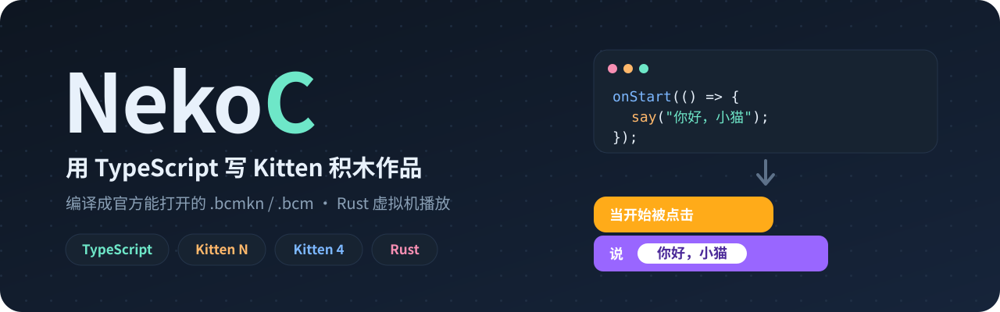

<p align="center">
  
</p>

# NekoC

**NekoC**（Neko Compiler）是一个面向编程猫 Kitten N（`.bcmkn`）和 Kitten 4（`.bcm`）作品的实验性编译器和运行时。

用 TypeScript 写代码 → 编译成 Kitten N 积木 → 导出官方编辑器能打开的 `.bcmkn`。

Kitten 4 目标和 Kitten N 共用同一个 TypeScript 前端，另外加了原生 `.bcm` 格式适配。支持范围和验证结果见 **[Kitten 4 支持与兼容性](docs/kitten4.md)**。

独立 IDE 项目已于 2026-11-08 暂时取消并移出当前范围；本项目继续维护编译器、运行时、平台适配和 Web Studio，不依赖 IDE 仓库。既有 IDE 成果仅作独立归档保留。

## 快速开始

### Web Studio

```powershell
cargo run --release --bin web -- samples/native-studio.bcmkn
```

打开 **<http://127.0.0.1:4173>**，打开或拖入 Kitten N `.bcmkn` / Kitten 4 `.bcm` 作品，就可以编辑积木、在 Rust 字节码虚拟机里运行，并按原格式导出。

- 舞台用 WebGL2 渲染，画笔采用二进制增量更新和常驻 GPU 画布。可以试试 `samples/web-pen-stress.bcmkn`（一万段画笔线）。
- 导入导出会原样保留暂不支持的积木；快速虚拟机遇到不支持的执行特性会报告出来。
- 超过请求大小的大作品可以用"压缩导出"，生成在官方播放器里也能自解压的 `.bcmkn`，见 **[压缩器](docs/pack.md)**。

已支持的执行特性、性能数据和限制见 **[Web Studio、格式支持与性能](docs/web-studio.md)**。

### PICKCAT 浏览器扩展

运行 `start-rust-backend.cmd`，再把 `dist/pickcat-rust` 作为已解压的扩展加载到 Chrome / Edge。它会把 PICKCAT 上的 Kitten N 和 Kitten 4 播放器换成本地的 Rust 播放器，带 FPS 显示、性能设置和切回原播放器的开关。

构建扩展用 `node tools/build-extension.mjs`，详见 **[安装与验证](docs/pickcat-extension.md)**。

### TypeScript 编译器

```bash
npm install
cargo build
```

```ts
// hello.ts
let score = 0;
onStart(() => {
  score = score + 1;
  console.log(score);
});
```

```bash
nekoc build hello.ts
```

`build` 不需要模板作品：舞台、角色、造型和初始坐标都可以写在同一个 `.nk.ts` 文件里声明（见 [samples/stage_demo.nk.ts](samples/stage_demo.nk.ts)）。只检查、不出包：

```bash
nekoc check hello.ts --json
```

`check` 依次做类型检查（对照 `ts/nekoc.d.ts`）、Kitten N 兼容检查和作品结构检查，每条诊断都带文件、行号、列号，适合 AI 反复修改后重跑。`.bcmkn` / `.bcm` 也可以直接 `check`。需要沿用已有作品的素材时，仍可用 `--template`：

```bash
nekoc compile-ts-bcmkn hello.ts --template samples/kitten-n-0.27.4.bcmkn --out hello.bcmkn
```

编译并打开 Kitten 4 画笔示例：

```powershell
cargo run --bin nekoc -- compile-ts-kitten4 samples/kitten4-demo.ts --out samples/kitten4-demo.bcm
cargo run --release --bin web -- samples/kitten4-demo.bcm
```

生成或修改 `.bcmkn` 后，可以用官方编辑器检查一遍兼容性：

```bash
node tools/editor-compat.mjs hello.bcmkn
```

## 命令行

| 命令 | 说明 |
|------|------|
| `check <input> [--json] [--no-types] [--template <t>]` | 只做类型、兼容和结构检查，不写文件；有错误时退出码为 1 |
| `build <input.ts> [-o <out.bcmkn>] [--template <t>] [--optimize]` | 编译成 `.bcmkn`；不给模板时用内置空作品，默认输出到源文件旁边 |
| `compile-ts <input.ts> --out <output.json>` | 把 TS 编译成工作区 JSON |
| `compile-ts-bcmkn <input.ts> --template <template.bcmkn> --out <out.bcmkn>` | 把 TS 编译成 `.bcmkn` |
| `compile-ts-kitten4 <input.ts> --out <out.bcm> [--template <template.bcm>]` | 把 TS 编译成原生 Kitten 4 `.bcm` |
| `compile-ts-scenario <input.ts> --template <t> --scenario <s> --out <out>` | 编译并按场景验证 |
| `decompile <input.bcmkn> --out <output.ts>` | 把 `.bcmkn` 反编译成 TypeScript |
| `inspect <input> --out <report.json>` | 查看 Kitten N / Kitten 4 作品结构 |
| `validate <input>` | 校验 Kitten N / Kitten 4 作品结构 |
| `run <input.bcmkn\|input.bcm> --ticks 30 [--event click]` | 默认用 Engine（默认 JIT）无头运行并输出快照；`--legacy-runtime` 保留旧解释器 |
| `run-scenario <input.bcmkn> <scenario.json>` | 运行场景测试 |
| `watch <input.ts> --template <t> --out <out>` | 监视文件变化并自动重新编译 |
| `diff <left.bcmkn> <right.bcmkn>` | 结构对比 |
| `roundtrip <input> <output>` | 两种格式的无损 JSON 往返 |
| `pack <input.bcmkn> --out <out.bcmkn>` | 压缩大文本列表，生成能在官方播放器里自解压的作品 |
| `unpack <input.bcmkn> --out <out.bcmkn>` | 把压缩过的作品还原 |
| `test <input.ts>` | 运行编译期单元测试 |
| `analyze-ir <ir.json> --out <report.json>` | 分析 IR |

### 选项

| 选项 | 说明 |
|------|------|
| `--optimize` | 开启常量折叠、死代码删除和表达式化简 |
| `--emit-ir <path>` | 额外输出 IR |
| `--emit-analysis <path>` | 额外输出分析报告 |

## 文档

- **[llms.txt](llms.txt)**：给 AI 用的精简说明：语法子集、舞台声明、API 和 check/build/run 迭代流程。在仓库里改代码的智能体另见 **[AGENTS.md](AGENTS.md)**。
- **[支持的 TypeScript 写法](docs/syntax.md)**：所有支持的语法结构。
- **[TS 写法支持情况（实测）](docs/ts-support-audit.md)**：逐条编译运行核对过的支持范围、限制和写法建议。
- **[API 参考](docs/api.md)**：事件、变量、列表、运动、外观、特效、画笔、克隆、侦测等全部函数。
- **[Self API](docs/self-api.md)**：角色回调里的 API（`self.move()`、`self.say()` 等）。
- **[运算符](docs/operators.md)**：算术、比较、逻辑、位运算和赋值运算符。
- **[Web Studio 与优化引擎](docs/web-studio.md)**：当前界面、Kitten N / Kitten 4 导入导出、Rust 字节码虚拟机、增量 WebGL2 渲染和实测数据。
- **[压缩器](docs/pack.md)**：自解压 `.bcmkn` 的格式和用法。
- **[Kitten N 兼容性](docs/kitten-n-compatibility.md)**：编辑器支持情况、模板和在线编辑器检查。
- **[Kitten 4 兼容性](docs/kitten4.md)**：原生 `.bcm` 目标、Web Studio 导入导出和校验。
- **[Kitten 4 积木覆盖](docs/kitten4-block-coverage.md)** / **[Kitten N 积木覆盖](docs/kn-block-coverage.md)**：逐个积木的实现、部分语义和设备降级状态。
- **[性能基准](docs/performance.md)**：与官方离线 Kitten 4 内核、HateNeko 的同场实测，含计量边界和不可比项。
- **[扩展接口](docs/extensions.md)**：用 Rust trait 或 JS 注册自定义积木和设备。
- **[播放器后端 SDK](docs/player-sdk.md)**：`nekoc::player`，把播放器运行时接到任意宿主（WebSocket、stdio、桌面壳、无头测试），含线上协议和帧格式。
- **[源码分析与最初的原生原型](docs/kitten-n-rust-rewrite.md)**：源码梳理和第一阶段重写记录；主界面之后已迁到 Web Studio。
- **[RGB 画笔显示器](modules/pen-display/README.md)**：RGB888 帧缓冲，可配置分辨率和目标刷新率；[可运行示例](samples/pen_display.bcmkn)。
- **[全舞台快速单角色渲染器](samples/pen_display_fast.bcmkn)**：896×560 舞台单位下的增量 RGB 画笔绘制；[源码](samples/pen_display_fast.ts)、[运行时源码分析](docs/kitten-n-runtime-findings.md)。
- **[按列渲染实验](samples/pen_display_columns.bcmkn)**：每一列一个角色；[源码](samples/pen_display_columns.ts)。
- **[原生微型 Transformer](projects/tiny-lm/tiny_lm.md)**：29,312 个训练参数，中文字符补全，原生数学运算和 KV cache；[可导入作品](projects/tiny-lm/tiny_lm.bcmkn)。这是针对合成语言的小范围实验，不是通用对话模型。

## 示例

### 事件和变量

```ts
let score = 0;
onClick(() => {
  score = score + 1;
  say(`得分：${score}`);
});
```

### 控制流

```ts
onStart(() => {
  for (let i = 1; i <= 10; i++) {
    moveSteps(i);
    turn(36);
  }
});
```

### 函数和递归

简单函数会内联展开；递归函数、有多个 `return` 的函数会自动编译成自制积木。

```ts
function fib(n: number): number {
  return n < 2 ? n : fib(n - 1) + fib(n - 2);
}

onStart(() => {
  say(fib(10));
});
```

### 广播

```ts
onStart(() => {
  broadcast("reset");
});
onMessage("reset", () => {
  setVar("score", 0);
});
```

### 列表和数组

```ts
onStart(() => {
  appendList("items", "hello");
  appendList("items", "world");
  if (listContains("items", "hello")) {
    say("找到了！");
  }

  const scores = [3, 9, 4];
  say(scores.filter((x) => x > 3).map((x) => x * 10).join(","));
});
```

### 多屏幕

```ts
screen("menu", { backdrop: "https://example.com/menu.png" }, () => {
  sprite("start", { costume: "https://example.com/start.png" }, () => {
    onStart(() => {
      switchScreen("game");
    });
  });
});

screen("game", { backdrop: "https://example.com/game.png" }, () => {
  sprite("player", { costume: "https://example.com/player.png" }, () => {
    onStart(() => {
      console.log("游戏开始");
    });
  });
});
```

### 角色 Self API

```ts
sprite("player", {
  costume: "https://example.com/player.png",
  x: 0,
  y: 0,
}, self => {
  self.onStart(() => {
    self.move(10);
    self.turn(90);
    self.say("你好！");
    self.setEffect("color", 50);
    self.penDown();
    self.setPenColor("#ff0000");
  });
});
```

### 编译期测试

```ts
function double(x: number) {
  return x * 2;
}

test("double", () => {
  expect(double(21)).toBe(42);
});
```

```bash
cargo run -- test my_tests.ts
```

## 优化器

用 `--optimize` 开启：

```bash
nekoc compile-ts input.ts --out output.json --optimize
```

优化会应用到主脚本、角色、场景内角色和自制积木，并用于最终的 `.bcmkn` 导出。

包含以下优化：

- **常量折叠**：编译时把 `2 + 3` 算成 `5`。
- **死代码删除**：从工作区语句入口遍历连接图，删除不可达的积木；保留未知事件入口和工作区元数据。
- **保守的表达式化简**：对确定返回数值的表达式执行乘以 1、除以 1、1 次幂等化简。混合类型变量的数值转换会保留；不会使用可能丢失副作用、NaN 或有符号零语义的 `x * 0`、`x ** 0`、`x + 0` 化简。零除数及非有限常量结果留给目标运行时处理。

## 运行时

`nekoc run` 默认使用与 Web 播放器、性能/兼容统计相同的 `engine::Engine`（默认 JIT），支持 Kitten N `.bcmkn` 和 Kitten 4 `.bcm`。这是无头执行，不创建窗口、播放声音或下载资源；需要可视化请使用 Web Studio。

```bash
nekoc run project.bcmkn --ticks 30
nekoc run project.bcmkn --ticks 1 --event click:100,200
nekoc run project.bcmkn --ticks 1 --event key-down:space
nekoc run project.bcm --frames 60 --seed 42 --out snapshot.json
nekoc run project.bcmkn --legacy-runtime --ticks 30
```

Engine 每 tick 固定推进 1/60 秒，默认 seed 为 1，快照标识为 `nekoc-engine-run-v1`。旧解释器是 30 Hz，快照、调度和事件语义不同；旧 `--expect` 文件请配合 `--legacy-runtime`，不会自动回退。`run-scenario` / `compile-ts-scenario` 仍使用旧解释器。选项、输出格式、云模拟及限制见 **[CLI 无头运行](docs/cli-run.md)**。

### 场景测试

```json
{
  "ticks": 2,
  "events": [
    { "kind": "click", "x": 15, "y": -20 }
  ],
  "expect": {
    "variables.kn-var-score": 1
  },
  "expect_trace": [
    { "kind": "start" },
    { "kind": "click", "x": 15, "y": -20 }
  ]
}
```

```bash
nekoc run-scenario project.bcmkn scenario.json
```

### Source Map

编译器会生成 source map，运行时轨迹里带有 `source_line` 和 `source_column`，方便定位到 TS 源码：

```json
{
  "tick": 1,
  "kind": "start",
  "owner_id": "actor-1",
  "block_id": "b1",
  "source_line": 2,
  "source_column": 0
}
```

## 测试

```bash
cargo test                          # Rust 测试
npm run typecheck                   # TypeScript 类型检查
npm run test:ts                     # TypeScript 单元测试
npm run test:tools                  # 工具和对照测试
node tools/editor-compat.mjs <作品>  # 用官方编辑器检查作品
```

## 项目结构

| 目录 | 内容 |
|------|------|
| `src/` | Rust 编译器、虚拟机（含 JIT）和 Web 后端 |
| `ts/` | TypeScript 前端和类型声明 |
| `web/` | Web Studio 与播放器 |
| `extension/` | PICKCAT 浏览器扩展 |
| `modules/` | 作品共用的积木模块 |
| `projects/` | 大型作品及其验证报告：`fangjie`、`pencraft`、`starhold`、`eisei`、`tiny-lm`、`qwen-mini` |
| `samples/` | 语言示例和测试夹具 |
| `tools/` | 构建、验证和性能分析脚本 |
| `tests/` | Rust 与 Node 测试 |
| `docs/` | 文档 |
| `dist/` | 打包产物 |

```
NekoC/
├── src/
│   ├── main.rs              # 命令行入口
│   ├── lib.rs               # 模块声明
│   ├── engine.rs            # Rust 字节码虚拟机（Web Studio / 播放器使用）
│   ├── engine/              # 虚拟机的值类型
│   ├── runtime/             # 场景测试用的解释型运行时
│   ├── bin/                 # web（Web Studio 服务）、基准测试等可执行程序
│   ├── studio/              # Web Studio 文档模型
│   ├── bcmkn.rs             # .bcmkn 读写
│   ├── bcmkn_compiler.rs    # TS → .bcmkn 编译流程
│   ├── kitten4.rs           # Kitten 4 .bcm 格式适配
│   ├── kitten4_compiler.rs  # TS → .bcm 编译流程
│   ├── pack.rs              # 自解压压缩器
│   ├── decompile.rs         # .bcmkn → TypeScript 反编译
│   ├── optimizer.rs         # 常量折叠、死代码删除
│   ├── scenario.rs          # 场景测试
│   ├── ir.rs / analysis.rs  # 中间表示和分析
│   ├── diff.rs / inspect.rs / validate.rs
│   └── ts_frontend.rs       # TypeScript 前端入口
├── ts/
│   ├── compile-ts.mjs       # TypeScript 编译器（JS）
│   └── nekoc.d.ts           # TypeScript 类型定义
├── web/                     # Web Studio 和播放器前端
├── extension/               # PICKCAT 浏览器扩展
├── modules/                 # 可复用的积木模块（如 RGB 画笔显示器）
├── tools/                   # 构建、验证和编辑器检查脚本
├── samples/                 # 示例作品
├── tests/                   # Rust 和 Node 测试
└── docs/                    # 文档
```

## 现状

- ✅ TypeScript → `.bcmkn` / `.bcm` 编译
- ✅ `.bcmkn` → TypeScript 反编译
- ✅ Rust 字节码虚拟机和 WebGL2 播放器
- ✅ 自解压压缩器
- ✅ 场景测试、监视模式、优化器、source map
- ✅ 覆盖面较广的 TS 语法：递归、数组和字符串方法、`try/catch` 等，见[实测支持情况](docs/ts-support-audit.md)
- ✅ 带类型定义的 Self API
- ✅ Kitten 4 播放器：以指定 hash 的官方离线内核核对调度、场景、克隆、变量、媒体、物理和画笔；审计清单映射入口无缺失、无 stub，但设备降级、partial 和未验证语义仍存在。[在线/离线取证](docs/compatibility/k4-online-vs-offline.md)仅证明指定发布物及三份作品的受控状态一致，不代表完整线上兼容
- ✅ 扩展接口 v1（Rust / JS）

## 仓库约定

不要往仓库里加第三方 `.bcmkn` 文件。大体积的编辑器打包文件、下载的编辑器资源、生成的报告和临时研究输出都应放在 Git 之外。

## 友情链接

- [HateNeko](https://github.com/SquCircle/HateNeko)：把 Kitten N 作品编译成 LÖVE（Love2D）程序的编译器与运行时。
