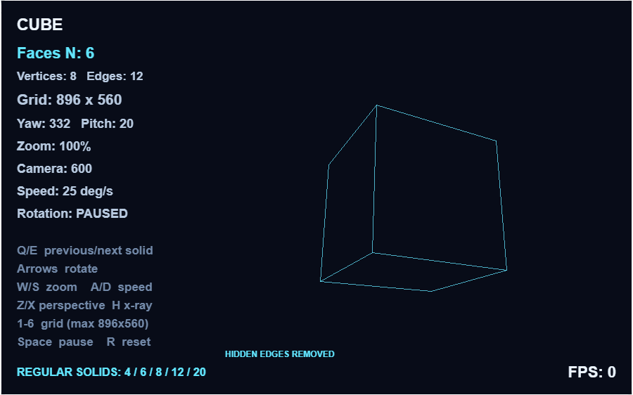
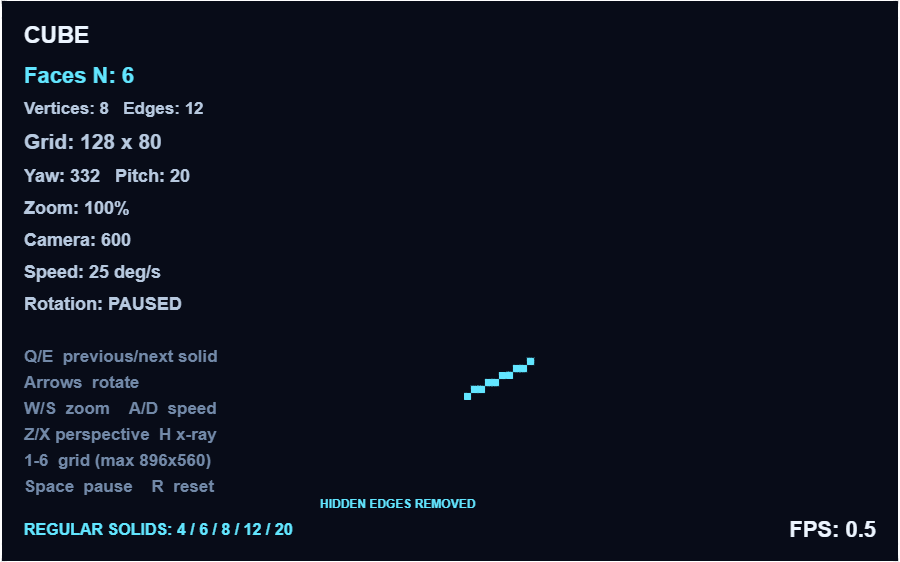

# 旋转正多面体画笔示例

导入 [`pen_polyhedron.bcmkn`](pen_polyhedron.bcmkn) 后开始运行。源码是 [`pen_polyhedron.ts`](pen_polyhedron.ts)。

采用五种凸正多面体（柏拉图立体），各面是全等正多边形，各顶点的面连接方式相同。默认是正六面体（立方体）及 **256×160** 网格，青色透视线框只显示可见棱，隐藏背面被遮挡的棱；按 H 可切换为显示全部棱的 X-ray 模式。

| 正多面体 | 面数 | 顶点数 | 棱数 | 每个面的形状 |
|---|---:|---:|---:|---|
| 正四面体 | 4 | 4 | 6 | 等边三角形 |
| 正六面体 | 6 | 8 | 12 | 正方形 |
| 正八面体 | 8 | 6 | 12 | 等边三角形 |
| 正十二面体 | 12 | 20 | 30 | 正五边形 |
| 正二十面体 | 20 | 12 | 30 | 等边三角形 |

Q/E 按 4 → 6 → 8 → 12 → 20 的顺序切换，在两端停止。顶点使用标准笛卡尔坐标（十二、二十面体含黄金比例），根据标准边长构造棱，并统一外接球半径为 160。

## 操作

| 按键 | 功能 |
|---|---|
| Q / E | 上一种 / 下一种正多面体 |
| 左 / 右方向键 | 水平旋转，每次 10° |
| 上 / 下方向键 | 俯仰，每次 10°，范围 −80°～80° |
| W / S | 放大 / 缩小，40%～130% |
| A / D | 自动转速减少 / 增加，0～90°/秒 |
| Z / X | 相机距离减少 / 增加，450～1200 |
| 1 / 2 / 3 | 32×20 / 64×40 / 128×80 |
| 4 / 5 / 6 | **256×160 / 448×280 / 896×560** |
| 空格 | 暂停 / 恢复自动旋转 |
| H | 隐藏背面棱 / X-ray 完整线框 |
| R | 恢复立方体、默认参数及 256×160 分辨率 |

Q/E、空格、H、1–6 和 R 在松开按键时触发一次，避免按住时重复切换。方向键和 W/S、A/D、Z/X 支持按住连续调整。

左上角显示立体名称、面数、顶点数、总棱数、分辨率、角度、缩放、相机距离和转速；底部显示当前隐藏棱 / X-ray 模式，右下角显示最近至少一秒的完整绘制帧率。暂停自动旋转时仍可手动调整和刷新。

六档逻辑分辨率分别使用 **28、14、7、3.5、2、1** 舞台单位大小的像素，显示范围始终是 **896×560**。最高档共 501,760 格，是原最高档 128×80 的 **49 倍**。三维顶点经过旋转、透视投影后，棱通过 DDA 栅格化到选定网格，再用原生画笔绘制像素，并非直接画矢量线。细网格使用不超出单格的画笔，避免旧的 2 单位边框撑破 1 单位像素。HUD 使用独立的原生文字印章，保证低分辨率下参数仍然可读。大幅缩放后超出模型窗口的像素会裁剪。

帧缓冲改为两个仅保存非空像素地址的原生列表，通过列表包含判断去重与比较，不再创建两个 `width×height` 的整屏列表。反馈角度下，896×560 立方体只记录 1,354 个可见线条像素，复杂二十面体测试记录 2,390 个。旧像素用能覆盖其四角的加宽背景色画笔擦除，再重画当前非空像素，修复擦除时波及的相邻像素，并消除抗锯齿残影。静止时不重复画模型。

参数面板最多每 0.2 秒刷新一次。稀疏缓冲减少的是初始化和存储量，不保证高帧率；列表包含判断和逐像素原生积木仍有成本。高档位复杂立体的一次重绘可能需要数秒，6 档更适合暂停观察或截图。FPS 表示本例实际完成的帧率，切换后的首帧可能暂显 0。

自动旋转以原生计时器的时间差计算角度；该计时器约每 50ms 更新，因此角度更新具有时间量化。分辨率切换会清空稀疏缓冲并重置 FPS 统计。按键在慢帧期间到达时，新的分辨率在下一帧边界应用。



## 透视与遮挡修正

相机位于 `(0, 0, -distance)`，朝向 `+Z`。投影缩放为 `distance / (distance + depth)`，近处放大、远处缩小。旧版本把前后棱画成同样亮的实线，背面棱穿过正面，会造成前后翻转的视觉歧义。

当前版本预生成五种立体的外向面平面及每条棱的两个相邻面。每帧将相机逆旋转回模型坐标，测试面是否朝向相机；一条棱的两个面都背向相机时隐藏该棱。原生运行时的三角函数会保留两位小数，旋转前对正弦/余弦对归一化，保证旋转不改变模型半径，遮挡判断也使用同一组旋转参数。

在反馈截图的 **Yaw 332°、Pitch 20°、Camera 600、128×80** 参数下，默认显示 9 条可见棱，X-ray 显示全部 12 条；正对立方体时只显示近面的 4 条棱。



## 编译与官方运行验证

```powershell
python tools/build-platonic-faces.py
cargo run -- compile-ts-bcmkn samples/pen_polyhedron.ts --template samples/kitten-n-0.27.4.bcmkn --out samples/pen_polyhedron.bcmkn
node node_modules/typescript/bin/tsc --noEmit --strict --lib es2020 ts/nekoc.d.ts samples/pen_polyhedron.ts
node --test tests/pen-display.test.mjs tests/platonic.test.mjs tests/polyhedron-projection.test.mjs
cargo run -- validate samples/pen_polyhedron.bcmkn

# 使用本机已缓存的官方运行时及 Playwright，全程离线。
$env:KN_SCENARIO='tools/polyhedron-perspective-actions.json'
$env:KN_FRAME_VARIABLE='__pd_frames'
node tools/tower-defense/verify.mjs samples/pen_polyhedron.bcmkn samples/pen-polyhedron-perspective-verification

$env:KN_SCENARIO='tools/polyhedron-hires-actions.json'
node tools/tower-defense/verify.mjs samples/pen_polyhedron.bcmkn samples/pen-polyhedron-hires-verification
```

当前[透视离线验证报告](pen-polyhedron-perspective-verification/report.json)通过 18 个步骤，覆盖截图角度、H 往返切换、正对立方体、五种立体、切换边界、原三档分辨率、近相机大俯仰及重置/暂停/恢复。[高分辨率报告](pen-polyhedron-hires-verification/report.json)另外通过 12 个步骤，覆盖 4/5/6 三档切换、最高档 X-ray 往返、正对立方体、二十面体极限姿态、自动旋转/暂停及退回低分辨率和重置。报告明确标记角度/相机等状态夹具，其余输入走官方键盘事件监听器。

两次验证的原生 VM 错误和警告均为 0，外部请求完成数为 0。验证使用官方编辑器内原生播放运行时的本地测试外壳；报告保留了缓存缺少编辑器外壳资源的记录。

23 项相关测试包括 6 项共享画笔显示测试、11 项几何/透视测试及 6 项逐档栅格测试。几何测试独立重建凸包支撑面，验证五种立体的规则性与拓扑，并用射线/凸包相交判断交叉验证多个视角下的棱遮挡，检查旋转保持半径和近面大于远面。逐档测试检查稀疏去重、像素裁剪、画笔宽度、静止时不重画及隐藏棱切换。报告的帧率采样对应暂停状态下的 128×80 立方体，不代表高分辨率连续旋转性能。

历史在线编辑器验证位于 `modules/pen-display/verification/platonic/`，旧棱锥版本位于 `verification/polyhedron/`；当前证据位于 `samples/pen-polyhedron-perspective-verification/` 和 `samples/pen-polyhedron-hires-verification/`。
