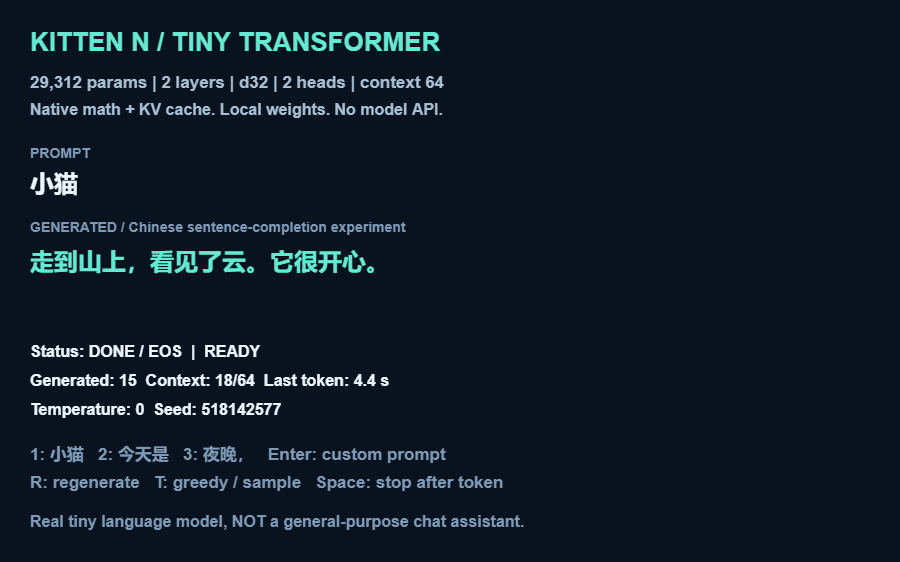

# Kitten N 原生微型 Transformer

**导入 [tiny_lm.bcmkn](tiny_lm.bcmkn)，点击开始即可运行。** 权重已经嵌入文件，播放不需要 Python、PyTorch、模型服务或网络。

这是一个真正运行在 Kitten N 原生积木上的字符级自回归语言模型实验，**不是通用聊天助手**。它只学过一小套原创合成中文短句，适合观察提示词预填充、注意力、KV 缓存及逐字生成。

## 操作

| 按键 | 功能 |
|---|---|
| 1 | 以“小猫”开头续写 |
| 2 | 以“今天是”开头续写 |
| 3 | 以“夜晚，”开头续写 |
| Enter | 原生输入框，自定义开头；最多 48 个词表内字符 |
| R | 清空上下文，重新生成 |
| T | 贪心选择 / 温度 0.7 采样，并重新生成 |
| 空格 | 当前 token 计算结束后停止 |

操作在松开按键时触发。慢 token 计算期间按下的重新生成请求会在 token 边界处理，界面不会每个乘加都刷新。默认最多生成 32 个字符；遇到结束符或达到 64-token 上下文容量会停止。提示词里有词表外字符时明确报错，不会偷偷替换。

Enter 打开输入框后，填写开头并点击旁边的 **✓ 确认按钮**提交；官方输入框不以再次按 Enter 自动提交。舞台上的键帽是按键提示，不是鼠标按钮。

可以尝试：`小猫`、`小熊在`、`今天是`、`夜晚，`、`小兔和小鹿`。这些是输入开头，**程序没有按提示词匹配预写答案**；后续每一个字符都来自模型输出的 logits。

## 模型

| 项目 | 配置 |
|---|---|
| 实际训练参数 | **29,312** |
| 词表 | **79**：77 个中文/标点字符 + BOS/EOS |
| Transformer | 2 层 decoder-only，隐藏维度 32 |
| 注意力 | 2 头，每头 16 维，因果注意力 |
| FFN | 32 → 128 → 32，ReLU，无偏置 |
| 归一化 | Pre-RMSNorm，epsilon = 0.00001 |
| 位置编码 | 64 项可训练位置嵌入 |
| 输出 | 与 token embedding 共享权重 |
| 解码 | 贪心，或数值稳定 softmax + 带种子采样 |
| 推理 | 原生矩阵向量乘、注意力、KV cache、归一化、输出投影 |

推理使用原生数值积木，不使用量化/查答案表，也不通过 JavaScript 插件、运行器注入或外部 API 计算。每个 token 的两层 K/V 保存到缓存，已消费 token 不再重新计算。

热循环的标量和工作列表使用官方脚本变量及临时列表积木。权重作为持久列表随作品保存，启动时复制一次；计算期间不对舞台列表逐项发出编辑器更新。输出文本、logits、生成 token ID 和耗时保留为可检查的普通变量/列表。

## 训练数据与能力边界

- 数据由 [`corpus.py`](../tools/tiny-lm/corpus.py) 在本机生成：小动物、地点、天气和心情的受限短句组合，没有下载语料或预训练检查点。
- 按完整且去重的文档切分：训练 3,159 条、验证 351 条；验证集是**同一合成语法中的未见组合**，不是开放语言理解测试。
- 离线 PyTorch 训练 1,800 步，batch 64，seed 1337。训练配置、损失历史、数据摘要及权重都保存在 [`model.json`](../assets/tiny-lm/model.json)。
- NumPy 验证集交叉熵 **0.4881 nats/token**，困惑度 **1.629**，top-1 准确率 **77.52%**；均匀随机基线交叉熵 4.3694。这些数值只能说明窄语法学习效果，不能外推为聊天能力。
- 训练文档最长 20 字。虽然实现有 64-token 容量，**长上下文位置没有得到充分训练**，容量不等于可靠长文本能力。
- 不支持词表外的汉字、英文或 emoji，不具备可靠事实知识、推理、指令遵循、多轮对话或安全问答能力。

## 验证证据

1. **训练结构 → NumPy：** [`training-parity.json`](../assets/tiny-lm/training-parity.json) 比较导出权重的 PyTorch FP64 前向与独立 NumPy 实现，包括完整 64-token 缓存边界。
2. **NumPy 完整上下文 → KV cache：** [`reference.json`](../assets/tiny-lm/reference.json) 保存六组提示词的参考 logits；两条算法最大差约 `7.83e-15`。
3. **源码算术 → NumPy：** `tests/tiny-lm.test.mjs` 执行生成的 TypeScript 内核，检查多组提示词的整组 logits、贪心生成、采样确定性、EOS、非法字符和作品结构。
4. **官方原生运行 → NumPy：** [`report.json`](tiny-lm-verification/report.json) 来自缓存官方 0.27.4 编辑器内原生运行时；[`numerical-parity.json`](tiny-lm-verification/numerical-parity.json) 在播放结束后重算和核对每组输出 ID 及 logits。参考计算**不参与作品执行**。

原生测试使用本地测试外壳、阻断外部网络，并核对执行模块工厂的哈希。它不是独立发布作品播放器验收；缓存缺少部分编辑器样式/外壳资源，报告如实保留这些记录。没有登录或发布。

原生完整贪心续写实测：

> 提示词：小猫  
> 模型续写：走到山上，看见了云。它很开心。

多轮测试中的速度约 **1–5 秒/字符**，依赖浏览器负载和上下文长度。当前保留的报告中，短续写约 3.2–3.7 秒/字符，完整句子生成 15 字，含提示词预填充与 EOS 共 **55.39 秒**；此前与其他测试重叠的一轮约 80 秒。**这不是流畅聊天速度保证**。界面计时器约以 50 ms 更新，`lm_token_ms` 是原生近似计时；报告的请求总耗时使用浏览器高精度墙钟，并包含提示词预填充和结束计算。

当前五组原生生成结果的 token ID 均与独立参考解码一致，整组最终 logits 最大绝对误差为 **1.15×10⁻¹⁴**；原生 VM 错误、警告和外部请求完成数均为 **0**。额外检查词表外输入会明确拒绝。



### 测试范围

- 当前模型与字符串输入连接回归 **15 项通过**，包括 64-token 数值边界、缓存重置、输出长度限制和非法提示词。
- 一轮全仓库 JavaScript 工具测试 **93 项通过**；之后新增的两个模型边界测试也在上述 15 项中通过。
- 严格 TypeScript 检查及作品原生结构验证通过。
- `cargo test --all-targets` 未全部通过：`tests/kitten4.rs` 的 `native_orientation_reporter_normalizes_and_rounds_degrees` 失败（期望 57.3，得到 90），单独复测同样失败。本次未修改该 Kitten 4 朝向实现；不将其计入模型成功项，也未扩大任务去修改这条无关路径。

## 源码与重建

- [`runtime.ts`](../modules/tiny-lm/runtime.ts)：注意力、解码、界面与控制。
- [`build.py`](../tools/tiny-lm/build.py)：生成专门化矩阵内核、编译作品、嵌入权重、局部化 scratch 数据。
- [`tiny_lm.ts`](tiny_lm.ts)：生成的完整可检查源码。**普通 compile-ts-bcmkn 不会自动嵌入权重，需使用构建器。**
- [`reference.py`](../tools/tiny-lm/reference.py)：独立 NumPy 完整与缓存推理。
- [`train.py`](../tools/tiny-lm/train.py)：离线训练，仅此步骤需要 PyTorch。

```powershell
# 已有权重：无需训练，Python 标准库即可构建；依赖已安装的 node/typescript 和 nekoc.exe。
python tools/tiny-lm/build.py
# 编译自行修改的完整源码，并从原作品保留权重；不会重新生成/覆盖输入源码。
python tools/tiny-lm/build.py --source D:/Downloads/tiny_lm_compatible.ts --banks-from D:/Downloads/tiny_lm.bcmkn --out D:/Downloads/tiny_lm_rebuilt.bcmkn
node node_modules/typescript/bin/tsc --noEmit --strict --lib es2020 ts/nekoc.d.ts samples/tiny_lm.ts
.\target\debug\nekoc.exe validate samples/tiny_lm.bcmkn
node --test tests/resource-inputs.test.mjs tests/tiny-lm.test.mjs

# NumPy 独立参考及评估
python tools/tiny-lm/evaluate.py

# 使用已缓存的官方运行时和 Playwright，全程离线验证作品。
node tools/tiny-lm/verify.mjs samples/tiny_lm.bcmkn samples/tiny-lm-verification
python tools/tiny-lm/check-native.py

# 可选：在单独的、已安装 PyTorch 的环境重新训练及检查导出。
python tools/tiny-lm/train.py --steps 1800
python tools/tiny-lm/check-training.py
```

训练依赖本次安装在 `D:/AppData/Local/Temp/opencode/kitten-n-tiny-lm-env`，只从 PyTorch CPU 依赖源下载，未更改项目的 npm 依赖。重训后应重新执行评估、构建、源码测试和原生验证，不要沿用旧报告。

本次同时修复编译器字符串 `.length` 的输入连接丢失问题，并增加独立回归测试。否则提示词长度在原生作品内被错误视为 0，虽能生成文字却未消费提示词。

### 中文界面修改版的兼容修复

修改版 `lm card` / `lm key` 使用带参数自制积木，实际触发官方编译检查 `procedure_no_such_parameter`（`lm card` 的 `hud-6`），作品尚未开始推理就被停止。`tools/tiny-lm/repair-ui.mjs` 仅将这两项绘图封装改为构建时内联的普通函数，保持每条笔画、中文文字、状态和模型算术；它是此界面的规避方案，**不是对编译器所有参数化自制积木的通用修复**。`tests/tiny-lm-ui.test.mjs` 逐笔对照原/修复封装，并检查编译后没有对应的原生参数读取。

`tools/tiny-lm/check-editor.mjs` 使用已有缓存，先核对原作品到工作区的导入连接，再渲染全部角色/自制积木工作区；所有网络被限制为本机。`verify.mjs` 支持中文/英文状态，完成后等待最后一轮 HUD 绘制再截图；`--controls-only` 补测重新生成、停止和原生自定义输入框。验证范围仍是上述本地官方缓存，不是在线发布验收。
